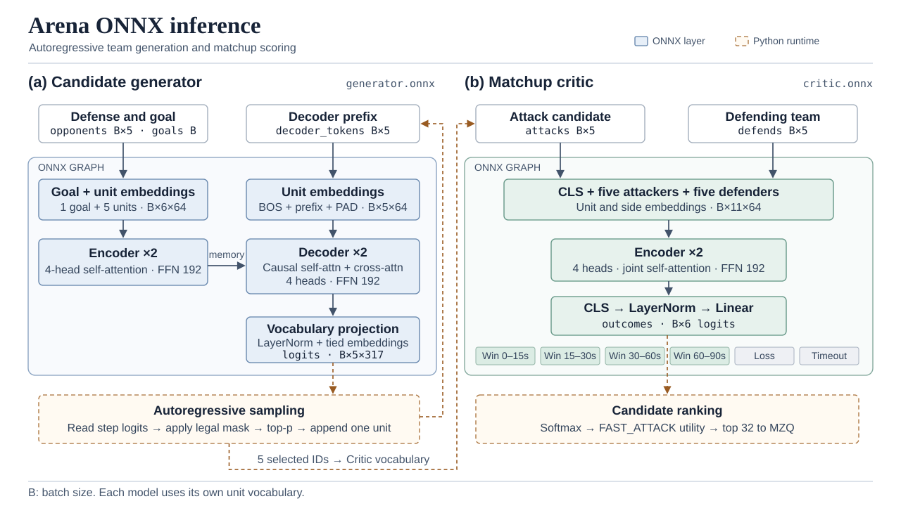

# Arena 竞技场查询

Arena 是 HoshinoBot 的公主连结竞技场插件。支持按角色昵称或截图查询拆队。完整五人防守会先查询 PCRDFans 作业，再用 ONNX 生成进攻候选并交给 MZQ 模拟。

## 部署

1. 将插件放在 HoshinoBot 的 `hoshino/modules/priconne/arena/`。Bot 运行用户需要能写入插件的 `buffer/` 目录并更新 `dic.npy`。
2. 模型功能需要 Python 3.10 或更高版本。在 Bot 使用的 Python 环境中，从插件目录安装 CPU 推理依赖。截图识别还需要 OpenCV 和支持 `Image.ANTIALIAS` 的 Pillow（例如 9.x）。

   ```bash
   python -m pip install -r requirements-model.txt
   ```

3. 将模型包放入插件的 `models/` 目录，也可以用 `ARENA_MODEL_DIR` 指定目录。每次部署都使用同一份模型包里的文件，保证权重、角色词表和清单对应。

   | 文件 | 用途 |
   |---|---|
   | `generator.onnx`、`vocabulary.json` | 生成进攻阵容及其角色词表 |
   | `manifest.json` | 模型文件校验、角色站位和模拟练度 |
   | `critic.onnx`、`critic_vocabulary.json` | 可选。给候选排序，并估计未模拟队伍的胜局耗时 |

4. 确认 Bot 能访问 PCRDFans 和 MZQ。PCRDFans 凭据可通过 Hoshino 的 `config.priconne.arena.AUTH_KEY` 设置。MZQ 地址默认是 `http://127.0.0.1:8080/simulate`。分开部署时，在 Bot 环境中设置 `ARENA_MZQ_URL`。
5. 启用 Hoshino 的 `pcr-arena` 服务。修改环境变量或更换模型包后，重载插件或重启 Bot，让新设置生效。

## 配置

| 环境变量 | 默认值 | 用途 |
|---|---|---|
| `ARENA_MODEL_DIR` | 插件目录下的 `models/` | 模型包路径 |
| `ARENA_MODEL_ENABLED` | `1` | 设为 `0` 时只查 PCRDFans 作业和缓存 |
| `ARENA_MZQ_ENABLED` | `1` | 设为 `0` 时保留模型候选，跳过模拟 |
| `ARENA_MZQ_URL` | `http://127.0.0.1:8080/simulate` | Bot 可访问的模拟接口 |
| `ARENA_MODEL_CANDIDATES` | `64` | 每支防守的生成候选上限，最大 256 |
| `ARENA_MZQ_CANDIDATES` | `32` | 每支防守送模拟的队伍上限，最大 64 |
| `ARENA_MZQ_REPEATS` | `10` | 每组攻守的模拟场数，最大 20 |
| `ARENA_MZQ_TIMEOUT` | `30` | 模拟请求超时秒数，最大 120 |
| `ARENA_MODEL_THREADS` | `2` | ONNX 推理线程数，最大 8 |
| `ARENA_MODEL_CACHE_SECONDS` | `900` | 同一防守、同一区服的内存缓存时长，单位秒 |
| `ARENA_RESULT_FONT` | 自动选择 | 中文显示异常时，指定可用的 TTF 或 TTC 字体 |

按区服限制进攻候选角色时，在 `manifest.json` 的 `region_rosters` 里填写角色 ID。区服键为 `1` 全服、`2` B 服、`3` 台服、`4` 日服。区服未配置时使用模型词表里的全部角色。模拟双方使用模型包的满练配置。部署时确认 MZQ 的角色数据与该配置兼容。

## 查询

- `bjjc` 查 B 服，`tjjc` 查台服，`rjjc` 查日服，`怎么拆` 查全服。指令后直接输入角色昵称，例如 `bjjc 佩可莉姆 可可萝 凯露 优衣 怜`。
- 截图可以随指令一起发送。也可以先发区服指令，再按 Bot 提示发送截图。单队支持完整或局部截图，多队查询建议发送完整的对战记录截图，插件会尝试给出角色互不重复的进攻组合。
- 截图识别依赖 Hoshino 的角色表和头像资源。插件每天同步一次，也可以发送 `竞技场更新卡池` 手动同步。四人或有未知角色的防守可返回库解或近似解。

示例可查看[单队查询](images/jjc.png)、[局部截图](images/part.png)、[多队查询](images/pjjc1.png)、[多队结果](images/pjjc3.png)、[近似解](images/approx.png)和[混合查询](images/misc.png)。

## 看结果

- **模拟结果** `9胜(27.6s) 1负(34.5s)` 表示分别对胜局和败局取平均用时，超时单独计数。Arena 用 Critic 的 `FAST_ATTACK` 分数挑选送模拟的队伍，未评分的队伍按生成概率补入名单。实测结果按胜率和平均胜局耗时排序。
- **旧库粗估** `≈25s` 是 Critic 估计的胜局耗时。缺少角色评分或置信度不足时显示「预估未知」。
- **库解**保留 PCRDFans 的赞踩和原阵容信息。模型队按模型包练度独立模拟。同一组角色在两种来源里都出现时，两条记录分别展示。

如果只有库解，先检查防守是否为词表支持的完整五人队，以及模型文件是否齐全。模型有结果但缺少模拟战果时，检查 `ARENA_MZQ_ENABLED` 和 `ARENA_MZQ_URL`。清单中的 `excluded_matchups` 会跳过指定的攻守组合。

## ONNX 网络架构



- **Generator** 的编码器读取防守和目标，解码器读取当前进攻前缀，并通过交叉注意力参考防守。输入角色嵌入和输出词表投影共用权重。当前包的 317 个词表项包括 315 个角色以及 `PAD` 和 `BOS`。
- **Critic** 用同一个编码器同时处理攻守两队，从 `CLS` 读取整场对局的表示。六个输出依次对应 0–15 秒获胜、15–30 秒获胜、30–60 秒获胜、60–90 秒获胜、失败和超时。Python 将它们转成概率后计算排序分数。
- `B` 表示批大小。两份模型各用自己的词表编码角色，Arena 用角色 ID 在两者之间传递阵容。模型内部均未使用角色位置嵌入，模拟时的站位由模型包另行提供。

## 致谢

本插件基于 0皆无0 的 [PCR姬器人：可可萝·Android](https://bbs.nga.cn/read.php?tid=18434108)，经原作者授权移植。感谢 IceCoffee 重构，以及 [ellye](https://github.com/watermellye) 实现截图查询。
